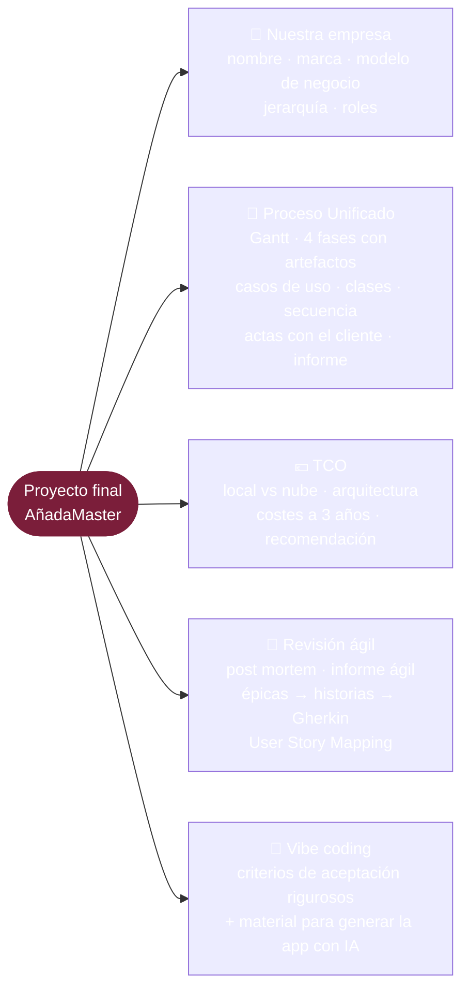
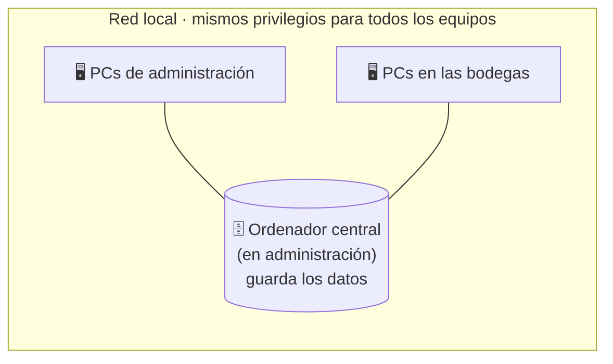
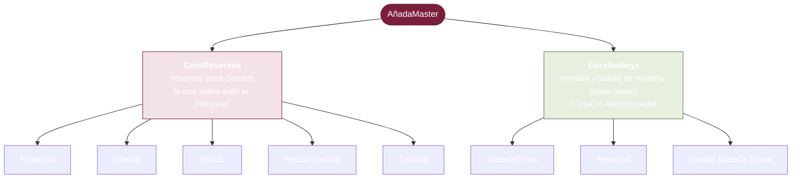
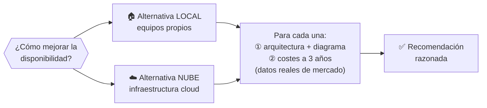
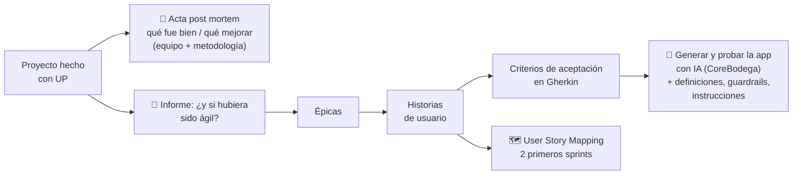
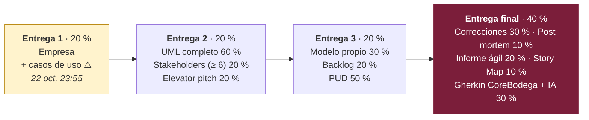
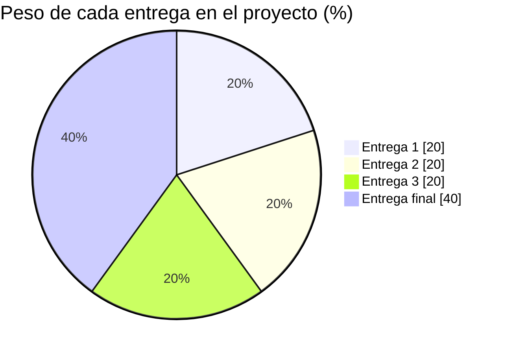
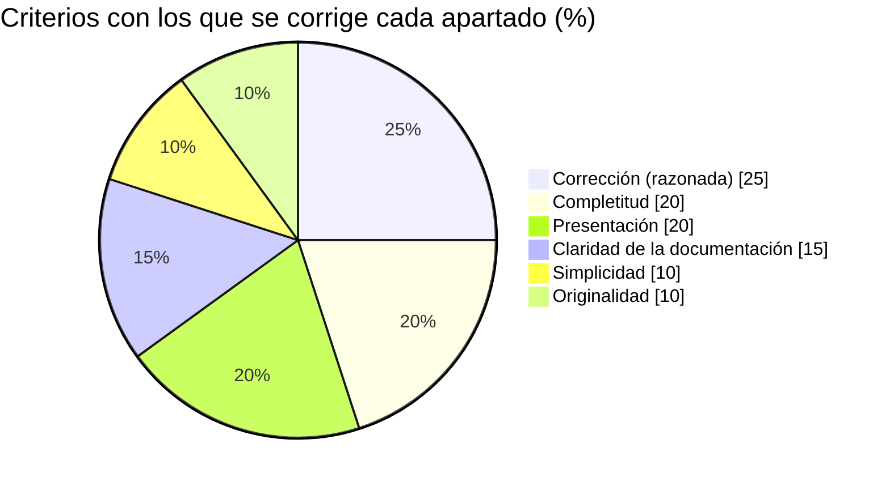

# Proyecto final · Resumen visual del enunciado

> Resumen de [`Enunciado Caso Práctico.pdf`](<Enunciado Caso Práctico.pdf>) (V 2.0, 14 páginas; las pp. 2 y 9 están en blanco). Las páginas citadas son las del PDF.
> Los diagramas son Mermaid: se ven en GitHub, GitLab y Obsidian. En VS Code necesitáis una extensión de Mermaid.
> Checklist de la entrega de hoy: [`entrega-1/README.md`](entrega-1/README.md).

## En 30 segundos

* Somos **4 personas** que montamos una **empresa de desarrollo de software** recién creada.
* Nuestro primer cliente es una **bodega**, que nos encarga **AñadaMaster**: un sistema de gestión con dos programas, **CoreReservas** y **CoreBodega**.
* Lo hacemos **orientado a objetos** y con **Proceso Unificado (UP)**. Al final analizamos qué habría cambiado con una metodología **ágil**.
* Además: un **TCO** que compara local y nube, un **post mortem**, **historias de usuario en Gherkin** y el material para generar la app **con IA** (*vibe coding*).
* El trabajo vale el **30 % de la asignatura**. Hay que sacar **al menos un 5 en la entrega final** para que cuenten las demás.

---

## 1 · El mapa del proyecto

---

## 2 · El cliente y lo que pide (pp. 3–5)

Una empresa de **producción y distribución de vinos**. AñadaMaster gestiona dos cosas:
la **revisión de inventarios en bodega** (entrada de materia prima y producción) y las
**reservas de botellas** para su cartera de clientes.

### Dónde corre

Hoy la aplicación antigua está en **una sola máquina local**: si se para, la empresa deja de trabajar. Nadie se ocupa de las incidencias y el equipo está en un sitio malo (se desconecta, se sobrecalienta). Esto es lo que motiva el TCO (p. 5).

### Los dos «Cores»

### Qué se puede hacer en cada opción

| Core | Opción | Alta | Modificar | Baja | Detalle importante |
|---|---|:-:|:-:|:-:|---|
| Reservas | **Producto** | ✓ | ✓ | — | Hay que **confirmar** los cambios |
| Reservas | **Cliente** | ✓ | ✓ | ✓ | Alta con plantilla (datos + domicilio). La baja borra de la BD. |
| Reservas | **Pedido** | ✓ | ✓ | ✓ | El cliente pide cambios o anulaciones **por teléfono**. Hay que confirmar. |
| Reservas | **Pedido Detalle** | ✓ | ✓ | ✓ | Se modifica la cantidad y el producto. Un botón aplica los cambios. |
| Reservas | **Factura** | — | — | — | **Imprime** el detalle del pedido (botón) |
| Bodega | **MateriaPrima** | ✓ | ❌ | ✓ | Datos, fecha, cantidad y descripción. Se elimina si hay devolución. **Validar.** |
| Bodega | **Personal** | ✓ | ✓ | ✓ | Datos personales + código de empresa. **Validar.** |
| Bodega | **Detalle Materia Prima** | ✓ | ❌ | — | Lo registra el Administrador. **Validar.** |

En CoreBodega queda registrado **qué usuario** hizo cada gestión.

### Usuarios

| Tipo | Privilegios | Dónde trabaja más |
|---|---|---|
| **Administrador** | Introducir y modificar datos | CoreBodega |
| **Personal** | Introducir y modificar datos (los mismos que el Administrador) | CoreReservas |

> El **cliente de la bodega** no usa el sistema: llama por teléfono y el personal hace los cambios por él.

### Decisiones ya tomadas por «nuestra empresa» (p. 5)

* Tecnología **orientada a objetos**
* Metodología **Proceso Unificado**. Al terminar, se analiza qué habría cambiado con otras metodologías.
* El cliente ofrece **al menos una reunión** para resolver dudas, cuando su responsable tenga hueco. De cada reunión hay que hacer un **acta**.

---

## 3 · TCO: local frente a nube (pp. 5–6)

**Requisitos que deben cumplir las dos alternativas:**

| Requisito | Qué significa |
|---|---|
| 🔁 **Redundancia** | Que la caída de un equipo no pare toda la organización |
| 🕘 **Disponibilidad** | De lunes a viernes, de **9 a 18 h** |
| 🧩 **Diseño completo** | Todos los equipos necesarios, con un **diagrama** |
| 💶 **Costes completos** | Desarrollo, despliegue y operación, con precios reales (PVP, salarios, calculadoras cloud). En local, la luz, la conectividad y la refrigeración ya van en el coste del edificio. |

Extra: el cliente también quiere saber qué **alternativas** hay en el mercado (otros productos o integraciones). No aparece en ninguna lista de entregas.

---

## 4 · Del UP a ágil y a la IA (pp. 6–7)

* **Vibe coding**: el cliente quiere poder modificar la app en el futuro con IA. Para eso necesita una **definición formal**: criterios de aceptación completos y rigurosos, y el **proceso** para regenerar la app a partir de ellos. Se excluye la parte del dispositivo móvil de materia prima, que no se describe en ningún otro sitio del enunciado.

---

## 5 · Calendario de entregas

> ⚠️ **E1:** Blackboard pide *empresa + diagramas UML de casos de uso* (rúbrica 4 × 25 %). El PDF (p. 10) pide *empresa + TCO* (4 × 25 %). Hay que confirmar con Jorge dónde queda el TCO.

| Entrega | Qué se pide (peso dentro de la entrega) |
|---|---|
| **E1** (Blackboard) | Empresa: nombre, marca, modelo de negocio, roles (25 %) · Diagramas UML de casos de uso (25 %) · Documentación y presentación (25 %) · Exposición en clase (25 %) |
| **E1** (PDF p. 10) | Empresa · las dos alternativas con su arquitectura · TCO a 3 años · recomendación (25 % cada una) |
| **E2** (p. 10) | Todos los UML: **casos de uso con especificaciones, clases y secuencia** (60 %) · mapa de stakeholders, mínimo 6 (20 %) · visión en formato *elevator pitch* (20 %) |
| **E3** (p. 11) | **Modelo de desarrollo propio**: nombre, etapas, roles, pros y contras, cuándo usarlo (30 %) · **backlog** de épicas + una épica en historias (20 %) · **PUD**: Gantt, artefactos de cada fase, actas, informe (50 %) |
| **Final** (p. 12) | Todo lo anterior corregido (30 %) · acta post mortem del PUD (10 %) · informe y acta ágil (20 %) · User Story Mapping de los 2 primeros sprints (10 %) · **todas las épicas de CoreBodega** en historias + **Gherkin** + material para generar y probar la app con IA (30 %) |

**Presentación:** de 5 a 15 minutos (p. 8). En E1, E2 y E3 no tienen que presentar todos, pero **todos deben presentar alguna vez** durante el curso.

---

## 6 · Cómo se puntúa (pp. 13–14)

### Reglas que pueden suspender el proyecto

* 🚫 **Falta un apartado** → el trabajo se considera incompleto y **no se aprueba**, aunque el resto esté bien.
* 🚫 **Menos de un 5 en la entrega final** → no cuentan las demás entregas.
* 🚫 **Proyecto o examen suspensos** → no se hace media.
* 🚫 **Fuera de plazo** → no se evalúa (diap. 15).
* 🚫 **Copia** (de otro grupo o de Internet) → se suspende **toda la asignatura** (diap. 16).
* ⚠️ **Redacción y ortografía** → pueden restar hasta un 20 % (diap. 15).

> El peso del proyecto en la nota no está claro: el enunciado y la presentación dicen **30 %**, y la guía docente 2026-27 dice **40 %**. La presentación de la asignatura lo divide en *20 % trabajo + 10 % presentación en clase*.

---

## 7 · Dudas abiertas del enunciado

* ¿La E1 es empresa + casos de uso (Blackboard) o empresa + TCO (PDF)? ¿Dónde va el TCO?
* **Alternativas de mercado** (p. 6): se piden en la descripción, pero no aparecen en ninguna entrega.
* **Dispositivo móvil** para registrar y evaluar la materia prima (p. 7): no se describe en ningún otro sitio. Hay que preguntarlo al cliente.
* **User Story Mapping**: ¿de todo el sistema (p. 8) o solo de CoreBodega (p. 12)?
* Administrador y Personal tienen «los mismos privilegios», pero CoreBodega lo usa el Administrador. Conviene aclararlo en la reunión con el cliente.
* **Erratas** que no hay que copiar: «Post Morten» → *post mortem*; «AñadaMáster» → *AñadaMaster*; «materia primer» → *materia prima*; «CoreBodegas» y «corebodega» → *CoreBodega*.
