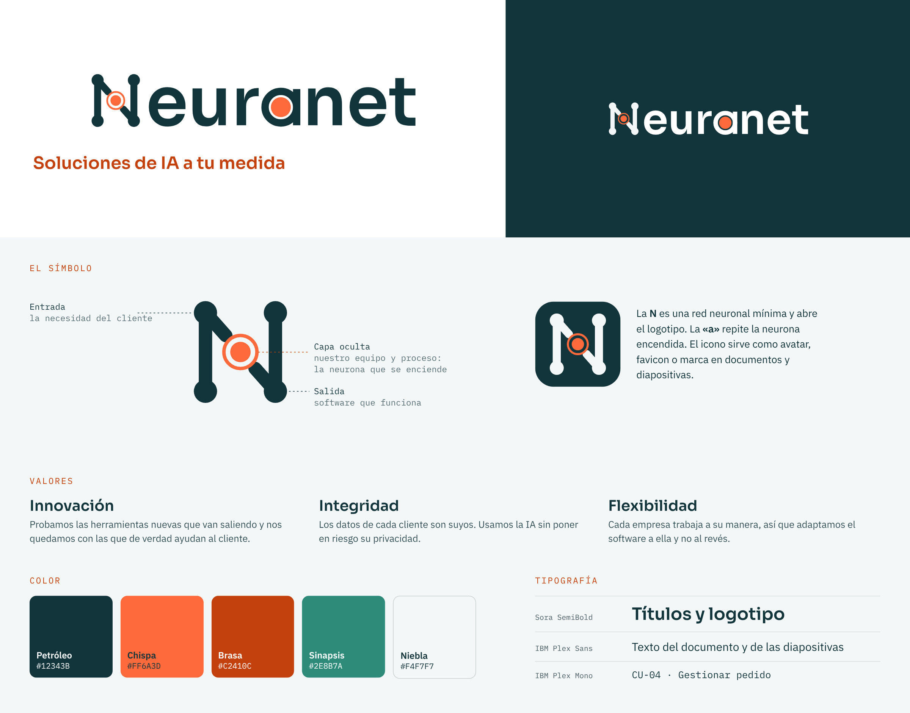

# Neuranet · Marca

> Guía de marca de Neuranet: logotipo, nombre, lema, valores, colores y tipografía.

## El logotipo

* La **N** es una **red neuronal mínima** y hace de primera letra de «Neuranet»:
  * **Entrada** (nodos de la izquierda): la necesidad del cliente.
  * **Capa oculta** (la neurona central, en naranja, «encendida»): nuestro equipo y nuestro proceso. Es el momento en que una idea se convierte en solución.
  * **Salida** (nodos de la derecha): software que funciona.
* La **«a»** está dibujada como un nodo (círculo + asta) con la misma neurona naranja dentro: repite la idea en mitad de la palabra.
* El **icono** (la N sobre fondo petróleo) se usa cuando el logotipo completo no cabe.

## Nombre, lema y valores

**Por qué Neuranet.** Une *neura* (redes neuronales) y *net* (red). Desarrollamos código con tecnologías pioneras en LLM, aprendizaje automático y redes neuronales, y nos mantenemos al día de cómo avanza la industria.

**Lema:** *Soluciones de IA a tu medida.*

| Valor | Qué significa para nosotros |
|---|---|
| **Innovación** | Probamos las herramientas nuevas que van saliendo y nos quedamos con las que de verdad ayudan al cliente |
| **Integridad** | Los datos de cada cliente son suyos. Usamos la IA sin poner en riesgo su privacidad |
| **Flexibilidad** | Cada empresa trabaja a su manera, así que adaptamos el software a ella y no al revés |

**Tono de voz:** claro, directo y sin jerga innecesaria. Frases cortas.

## Color

| Nombre | HEX | Uso |
|---|---|---|
| **Petróleo** | `#12343B` | Color principal: logotipo, títulos y texto. Contraste 13,3:1 sobre blanco. |
| **Chispa** | `#FF6A3D` | Acento: solo la neurona y algún detalle gráfico. **No usar para texto sobre blanco** (2,9:1). |
| **Brasa** | `#C2410C` | Acento para texto o enlaces sobre fondo claro (5,2:1) |
| **Sinapsis** | `#2E8B7A` | Secundario para diagramas (relleno de clases, fondo de actores…) |
| **Niebla** | `#F4F7F7` | Fondo claro de diapositivas y portada |

## Tipografía (gratis en Google Fonts)

* **Sora SemiBold**: títulos y logotipo
* **IBM Plex Sans**: texto del documento y de las diapositivas
* **IBM Plex Mono**: identificadores y código (`CU-01`, nombres de clases)

El logotipo está en trazados (paths), así que se ve igual aunque no tengáis las fuentes instaladas. Para escribir con ellas en Word, Google Docs o Slides sí hay que instalarlas o activarlas.

## Ficheros

| Fichero | Para qué |
|---|---|
| `neuranet-logo-color` | Logotipo principal, sobre fondo blanco o claro |
| `neuranet-logo-negativo` | Sobre fondo petróleo u otro fondo oscuro |
| `neuranet-logo-mono` / `-mono-blanco` | En un solo color (impresión en B/N, sellos, marcas de agua) |
| `neuranet-simbolo-*` | Solo la N, para espacios pequeños |
| `neuranet-icono` | Icono con fondo: avatar, favicon, esquina de las diapositivas |

Cada logo está en `svg/` (vectorial, para escalar sin perder calidad) y en `png/` (fondo transparente, 4×, para pegar en Word o Slides).
Las plantillas de documentos con esta marca están en [`templates/`](../../templates/README.md).

## Normas de uso

* Dejad alrededor del logo un margen libre de al menos **el diámetro de un nodo**.
* El logotipo no debe medir menos de **3 cm** de ancho. Por debajo, usad el símbolo o el icono.
* No cambiéis los colores, no lo deforméis ni lo giréis, y no le pongáis sombras ni degradados.
* Las dos neuronas (la de la N y la de la «a») siempre van en Chispa, salvo en las versiones de un solo color.
* No lo pongáis sobre fotos o fondos con poco contraste: usad el negativo o el icono.
